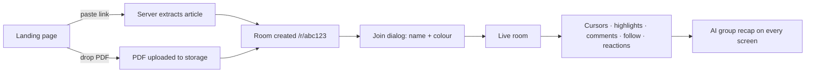
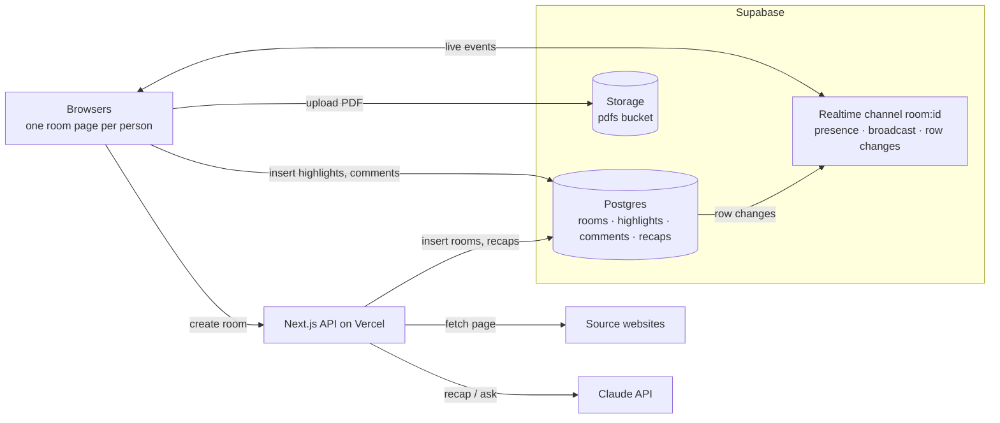

# LinkRoom: Master Document

> **The internet is single-player. LinkRoom makes every link multiplayer.**

This is the single source of truth for the project: what LinkRoom is, what we are building, which stack we use, which features are in scope, and how the UI must look. If something here conflicts with a chat message or an old note, this file wins. The step-by-step build tasks live in [CHECKLIST.md](CHECKLIST.md), and the longer reasoning and code samples live in [docs/IMPLEMENTATION_PLAN.md](docs/IMPLEMENTATION_PLAN.md).

---

## 1. Hackathon context

| Item | Detail |
| --- | --- |
| Event | TRMI x LovHack hackathon |
| Theme | **Multiplayer Everything** |
| Team size | 2 to 4 people |
| Build window | 31 hours |
| Applications close | Sat Oct 31, 10:29 AM IST |
| Kickoff (theme, rules, judging) | Sat Oct 31, 7:30 PM IST |
| Our submission target | Mon Nov 2, 1:30 AM IST |
| Official submission deadline | Mon Nov 2, 2:30 AM IST |
| Winners announced | Mon Nov 2, 5:30 AM IST |

Confirm the rules and Devpost fields at kickoff. Application code is written only after kickoff.

---

## 2. Core idea

LinkRoom turns **any link or any PDF into a live multiplayer room in one click**.

1. Paste a URL (Wikipedia, a blog post, docs, a news article) or drop a PDF (a research paper, lecture notes, slides).
2. LinkRoom creates a room with a short shareable link. Creating a room needs an account (email + password, verified by email).
3. Friends open the link, type a name, and they are in. Guests need no login and nothing to install.
4. Everyone reads the same content together. They see each other's live cursors, highlight text, discuss highlights in comment threads, follow each other's scroll, throw emoji reactions, and finally ask the AI for a **group recap** that appears on every screen at once.

### The problem

Today we share a link in a group chat, everyone reads it alone, and the discussion happens through screenshots and "which paragraph?" messages. Reading on the internet is single-player.

### Who it is for

- **Study groups** reading a paper or notes the night before an exam.
- **Teams** reviewing docs, specs or a competitor's blog post.
- **Friends** discussing a news article or an essay.

### Why it fits the theme

- It works on almost **any** link or PDF, so it really is "multiplayer everything".
- It is only useful with other people. Alone, it is just a reader.
- Judges can join a live room from a single URL or QR code in about 10 seconds.
- Even the AI is multiplayer: the recap summarises what the **group** highlighted and argued about, and everyone sees it together.

### Non-goals

We are **not** building accounts, a browser extension, voice chat, co-editing of the document, or an iframe/proxy of the original site. These cost a lot of time and add little to the demo.

---

## 3. What we are building

### User flow



### Pages

| Route | Page | Purpose |
| --- | --- | --- |
| `/` | Landing page | Paste a link, drop a PDF, or join a live demo room |
| `/r/[id]` | Room | The shared reading space |
| `/r/[id]` (error state) | Fallback | "We couldn't read this page" with a Paste text instead option |

### API routes

| Route | Method | Does |
| --- | --- | --- |
| `/api/rooms/link` | POST | Validates the URL, fetches it, extracts the article, sanitizes it, adds block IDs, saves the room |
| `/api/rooms/text` | POST | Creates a room from pasted text (fallback) |
| `/api/rooms/pdf` | POST | Saves an uploaded PDF's storage path and creates the room |
| `/api/rooms/[id]/recap` | POST | Sends highlights, comments and text to Claude and saves the recap |
| `/api/rooms/[id]/ask` | POST | (P2) Answers a question about a paragraph, visible to the whole room |

### What is stored and what is not

| Data | Where | Why |
| --- | --- | --- |
| Rooms, highlights, comments, recaps | Supabase Postgres | They must survive a refresh; new rows reach everyone through realtime |
| Uploaded PDFs | Supabase Storage (`pdfs` bucket) | Files |
| Cursors, scroll position, reactions, presence | Realtime broadcast and presence only | High frequency and short-lived; never written to the database |
| Name and colour | Browser localStorage | No accounts |

---

## 4. Tech stack

One Next.js app on Vercel plus one Supabase project. There is no separate backend server.

| Layer | Choice | Why |
| --- | --- | --- |
| Framework | **Next.js (App Router) + TypeScript** | Pages and API routes in one codebase |
| Styling | **Tailwind CSS** | Fast, consistent styling |
| Components | **shadcn/ui** (Radix based) | Accessible dialogs, popovers, toasts, sheets |
| Animation | **framer-motion** | Smooth cursor gliding, floating reactions, panel transitions |
| Icons | **lucide-react** | Comes with shadcn/ui |
| Database | **Supabase Postgres** | Rooms, highlights, comments, recaps |
| Realtime | **Supabase Realtime** | Presence, broadcast and row changes in one channel |
| File storage | **Supabase Storage** | Uploaded PDFs |
| Link extraction | **@mozilla/readability + jsdom** (switch to `linkedom` if the function is too big) | Turns a messy page into clean article HTML |
| Sanitizing | **isomorphic-dompurify** | Strips scripts from extracted pages |
| PDF rendering | **react-pdf** (pdf.js) with the text layer on | Selectable text so highlights work |
| AI | **@anthropic-ai/sdk + zod**, model `claude-opus-5-5` | Structured JSON recaps |
| IDs and QR | **nanoid**, **qrcode.react** | Short room links and phone joining |
| Hosting | **Vercel** | Deploys on every push to `main` |

```bash
# run from the repo root so the app lives at the root, not in a subfolder
npx create-next-app@latest . --ts --tailwind --app --eslint
npx shadcn@latest init
npm i @supabase/supabase-js @mozilla/readability jsdom isomorphic-dompurify react-pdf @anthropic-ai/sdk zod nanoid framer-motion qrcode.react
```

### Environment variables

| Name | Used by | Secret? |
| --- | --- | --- |
| `NEXT_PUBLIC_SUPABASE_URL` | Browser and server | No |
| `NEXT_PUBLIC_SUPABASE_ANON_KEY` | Browser and server | No (public by design, protected by RLS) |
| `SUPABASE_SERVICE_ROLE_KEY` | Server only | **Yes** |
| `ANTHROPIC_API_KEY` | Server only | **Yes** |

Secrets go in `.env.local` and in Vercel project settings. Never commit them and never paste them in chat.

### Architecture



### Folder structure

```text
app/
  page.tsx                      landing page
  r/[id]/page.tsx               room (server component loads the room)
  api/rooms/link/route.ts
  api/rooms/text/route.ts
  api/rooms/pdf/route.ts
  api/rooms/[id]/recap/route.ts
components/
  room/ArticleView.tsx  PdfView.tsx  CursorLayer.tsx  PresenceBar.tsx
  room/HighlightToolbar.tsx  CommentPanel.tsx  RecapPanel.tsx
  room/FollowBanner.tsx  ReactionLayer.tsx  ShareButton.tsx  JoinDialog.tsx
  landing/LinkInput.tsx  PdfDropzone.tsx  DemoRooms.tsx
  ui/                           shadcn components
lib/
  supabase/client.ts  supabase/admin.ts
  useRoomChannel.ts  anchors.ts  highlights.ts  extract.ts  identity.ts  throttle.ts
supabase/
  schema.sql
```

### Key engineering decisions

- **One anchor model.** Every paragraph of a link room is a block (`b0`, `b1`, …) and every PDF page is a block (`p1`, `p2`, …). Cursors are sent as `{ block, x, y }` relative to that block, and highlights are stored as `{ block_id, start_offset, end_offset, quote }`. This works across different screen sizes, and link and PDF rooms share the same code.
- **Highlights stay inside one block** in the MVP. Multi-block highlights are out of scope.
- **Throttle realtime events:** cursors every 50 ms, scroll every 200 ms.
- **Security:** only `http`/`https` URLs, block private and local hosts (SSRF), DOMPurify on every extraction, 10 s fetch timeout, 20 MB PDF limit. Anonymous select and insert are allowed by RLS for the hackathon; say so in the README.

The full SQL schema and code for the hard parts are in [docs/IMPLEMENTATION_PLAN.md](docs/IMPLEMENTATION_PLAN.md).

---

## 5. Features

Ship **every P0 before starting any P1**. Start P2 only if all P0 and P1 work is stable by Sunday 4 PM IST. P3 is the "do not build" list.

### P0: Must have (the MVP)

| # | Feature | What it does |
| --- | --- | --- |
| 1 | Link to room | Paste a URL; it is extracted in reader mode and a room is created |
| 2 | PDF to room | Drop a PDF; it is stored and rendered page by page |
| 3 | Join with name, no login | Enter a name, get a random colour, you are in |
| 4 | Shareable room link | Short URL plus a Copy button |
| 5 | Presence bar | Avatars of everyone online |
| 6 | Live cursors | Named, coloured cursors that glide smoothly |
| 7 | Shared highlights | Select text, highlight it, everyone sees it live in your colour |
| 8 | Comment threads | Discuss any highlight in a side panel |
| 9 | Error fallback | Clear message plus Paste text instead when a site can't be read |

### P1: Features that win

| # | Feature | What it does |
| --- | --- | --- |
| 10 | Follow mode | Click an avatar to follow their scroll; Bring everyone here button |
| 11 | AI group recap | Claude summarises what the group highlighted and debated; appears on every screen at once |
| 12 | Emoji reactions | Floating reactions on a paragraph |
| 13 | QR code join | QR code in the room header for phones |
| 14 | Live demo rooms | Join a live room now on the landing page |
| 15 | Activity feed | Who highlighted or commented on what |
| 16 | Mobile-friendly room | Usable layout on a phone |

### P2: Stretch (only if time is left)

| # | Feature | What it does |
| --- | --- | --- |
| 17 | Attention heatmap | Margin bar showing which paragraphs the group read and highlighted most |
| 18 | Ask AI about a paragraph | Question and answer are visible to the whole room |
| 19 | Agree / disagree votes | Vote on highlights and comments |
| 20 | Export notes | Download highlights, comments and recap as Markdown |
| 21 | Synced YouTube | Shared playback with timestamp comments |
| 22 | One-line script SDK | A script tag that adds cursors and comments to any website |
| 23 | Session replay | Replay how highlights and comments unfolded |

### P3: Do not build

Login for room guests, multi-block highlights, voice chat, showing the original site through a proxy or iframe, co-editing the document, a browser extension, private rooms and permissions. Mention the useful ones as "future work" in the pitch.

### The AI recap output

The recap is structured JSON validated with zod:

```json
{
  "one_line_summary": "string",
  "key_points": ["string"],
  "what_the_group_cared_about": [{ "quote": "string", "who": ["Priya"], "why": "string" }],
  "disagreements": ["string"],
  "open_questions": ["string"],
  "next_steps": ["string"]
}
```

It is saved in the `recaps` table, so it reaches every browser through realtime at the same moment. The recap button is disabled for 30 seconds after use, and the Anthropic Console has a spending limit.

---

## 6. UI design guidelines

The look is **calm reader first, playful multiplayer second**. The content must be pleasant to read for a long time; the colourful parts are the people (cursors, avatars, highlights, reactions).

### Design principles

1. **Content is the hero.** Reader-mode typography, generous whitespace, a narrow text column.
2. **People are colour.** Each person has one colour used everywhere: cursor, avatar ring, highlights, comment accent. The rest of the UI is neutral.
3. **Show life immediately.** Something should move within 2 seconds of joining: cursors, a "Priya joined" toast, a reaction.
4. **Never dead-end.** Every error has a next action (Paste text instead, Try another link, Retry).
5. **One click to share.** The Share button is always visible in the room header.

### Colour

| Token | Light | Dark | Use |
| --- | --- | --- | --- |
| `--background` | `#FAFAF9` | `#0C0A09` | Page background |
| `--surface` | `#FFFFFF` | `#1C1917` | Cards, panels, dialogs |
| `--foreground` | `#1C1917` | `#F5F5F4` | Body text |
| `--muted` | `#78716C` | `#A8A29E` | Secondary text, timestamps |
| `--border` | `#E7E5E4` | `#292524` | Dividers, outlines |
| `--primary` | `#4F46E5` | `#818CF8` | Main buttons, links, focus rings |
| `--danger` | `#DC2626` | `#F87171` | Errors |

**Person colours** (assigned at random on join, chosen to work in both themes):

`#EF4444` red · `#F97316` orange · `#EAB308` amber · `#22C55E` green · `#14B8A6` teal · `#3B82F6` blue · `#8B5CF6` violet · `#EC4899` pink

Highlights use the person colour at **25% opacity** in light mode and **35%** in dark mode, so text stays readable.

Dark mode is required. Use shadcn's CSS variables and the `class` strategy, and follow the system setting by default.

### Typography

| Element | Font | Size / weight |
| --- | --- | --- |
| UI (buttons, labels, panels) | **Inter** | 14px, 500 |
| Article body (link rooms) | **Source Serif 4** (or Georgia) | 18–19px, line height 1.7, max width 68ch |
| Headings in the article | Source Serif 4 | 28 / 22 / 18px, 600 |
| Landing hero | Inter | 48px desktop, 32px mobile, 700 |
| Cursor name tags, timestamps | Inter | 12px, 500 |
| Code blocks | **JetBrains Mono** | 14px |

Load fonts with `next/font` to avoid layout shift.

### Spacing, shape, motion

- Spacing on a 4px scale (Tailwind default). Panels use 16–24px padding.
- Radius: 8px for buttons and inputs, 12px for cards and panels, full for avatars.
- Shadows: soft and rare, only on floating things (toolbar, popovers, cursors' name tags).
- Motion: 150–250 ms, ease-out. Cursors glide with a spring. Reactions float up and fade over about 1.5 s. Respect `prefers-reduced-motion`.

### Landing page layout

```text
┌──────────────────────────────────────────────────────────┐
│ LinkRoom                                    [GitHub] [◐] │
│                                                          │
│        Make any link multiplayer.                        │
│        Read, highlight and discuss together, live.       │
│                                                          │
│   ┌───────────────────────────────────────┐ ┌──────────┐ │
│   │ Paste any link…                       │ │ Create → │ │
│   └───────────────────────────────────────┘ └──────────┘ │
│   ┌ ─ ─ ─ ─ ─ ─ ─ ─ ─ ─ ─ ─ ─ ─ ─ ─ ─ ─ ─ ─ ─ ─ ─ ─ ─ ┐  │
│     or drop a PDF here (max 20 MB)                       │
│   └ ─ ─ ─ ─ ─ ─ ─ ─ ─ ─ ─ ─ ─ ─ ─ ─ ─ ─ ─ ─ ─ ─ ─ ─ ─ ┘  │
│                                                          │
│   Live rooms right now                                   │
│   [Wikipedia: Internet ● 3]  [arXiv paper ● 2]  [Essay]  │
│                                                          │
│   How it works:  1 Paste  →  2 Share  →  3 Read together │
└──────────────────────────────────────────────────────────┘
```

- The link input is autofocused. Enter submits.
- While a room is being created, the button shows a spinner and the text "Building your room…".
- Demo room cards show live presence counts.

### Room layout (desktop, 1280px and up)

```text
┌──────────────────────────────────────────────────────────────────────┐
│ ← LinkRoom │ Internet – Wikipedia      (A)(P)(R)+2  [QR] [Share] [◐]│  header 56px
├──────────────────────────────────────────────────────────────────────┤
│ Following Priya · Stop                                               │  follow banner (only when following)
├──────────┬─────────────────────────────────────┬─────────────────────┤
│ heatmap  │                                     │ [Comments][Activity]│
│ (P2)     │   Article title                     │ [Recap]             │
│          │                                     │                     │
│          │   Paragraph text with ▓highlights▓  │  "quoted text"      │
│          │      ↖ Priya                        │  Priya: why is…     │
│          │                                     │  Arun: because…     │
│          │   Paragraph text…   🔥              │  [Reply…]           │
│          │                                     │                     │
│          │   (column max 68ch, centred)        │  [✨ Recap the room] │
└──────────┴─────────────────────────────────────┴─────────────────────┘
                                                       side panel 380px
```

- **Header:** back to home, document title (truncated), presence avatars (max 5, then "+N"), QR button, Share button (copies the link and shows a toast), theme toggle.
- **Reading column:** centred, max 68ch for links; PDFs fit the column width and render lazily.
- **Side panel:** tabs for Comments, Activity and Recap. Collapsible.
- **Highlight toolbar:** appears above a text selection with Highlight, Comment and (P2) Ask AI buttons.
- **Cursors:** an arrow in the person's colour plus a small name tag; fades after 5 s idle.
- **Avatars:** circle with initials on the person's colour; click to follow; tooltip shows the name.

### Room layout (mobile, under 768px)

- Header shrinks to title, presence count and Share.
- The side panel becomes a bottom sheet opened by a floating Comments button.
- Cursors of others are shown; your own pointer is not broadcast on touch.
- Highlight by long-press selection; the toolbar appears below the selection.

### Components and states

| Component | Must have |
| --- | --- |
| JoinDialog | Name input (max 24 chars), colour preview, Join button, remembers you via localStorage |
| PresenceBar | Avatars with colour ring, "+N" overflow, tooltip names, click to follow |
| CursorLayer | Spring animation, name tag, idle fade, ignores your own cursor |
| HighlightToolbar | Appears on selection, disappears on click away, keyboard accessible |
| CommentPanel | Threads grouped by highlight, newest last, author colour dot, relative time |
| RecapPanel | Loading skeleton, sections for each recap field, "Recapped by Arun · 2 min ago" |
| FollowBanner | "Following Priya · Stop", stops automatically if you scroll yourself |
| Toasts | Joined / left, link copied, recap ready, errors |
| Empty states | "No highlights yet. Select any text to start." |
| Error state | Friendly message, Paste text instead, Try another link |

### Copy tone

Short, friendly, plain English. Examples: "Building your room…", "Priya joined", "Link copied. Send it to your friends.", "We couldn't read this page. Paste the text instead?".

### Accessibility

- Text contrast at least 4.5:1 in both themes.
- Every interactive element is reachable by keyboard and has a visible focus ring.
- Icon buttons have `aria-label`s.
- Never use colour alone to identify a person; always show the name too.

---

## 7. Demo plan (summary)

A 2:30 video with three people in one room in the first minute: problem (0:00), create and join (0:20), read together with cursors, highlights, comments, reactions and follow mode (0:50), drop a PDF (1:30), AI recap on every screen (1:55), close with the live URL and QR code (2:20). During live judging, show the QR code and ask a judge to paste **their own** link. The full script and the submission checklist are in [CHECKLIST.md](CHECKLIST.md) and [docs/IMPLEMENTATION_PLAN.md](docs/IMPLEMENTATION_PLAN.md).

## 8. Team roles (team of 4)

| Member | Owns |
| --- | --- |
| A: Realtime and frontend | Realtime channel, presence, cursors, follow mode, reactions |
| B: Backend | Supabase schema, storage, link extraction, PDF upload, env vars, deploys |
| C: Content and AI | ArticleView, PdfView, highlights, comments, AI recap |
| D: Product and demo | Landing page, design, demo rooms, testing, video, README, Devpost |

With 3 people, split D's work across the team. With 2 people, one takes A + C, the other takes B + D, and the only P1 feature is the AI recap.

## 9. Ground rules

- Short-lived feature branches, small PRs, merge to `main` often. `main` must always deploy.
- Every phase ends in a deployed, working state.
- Feature freeze at **Sun 8 PM IST**. After that, only bug fixes.
- Demo only with pre-tested links and PDFs, and keep a recorded video as backup.
