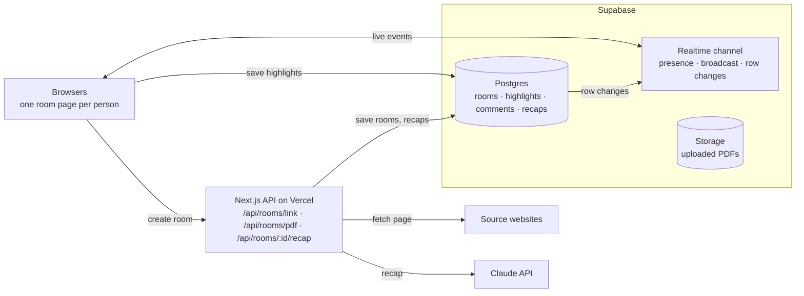
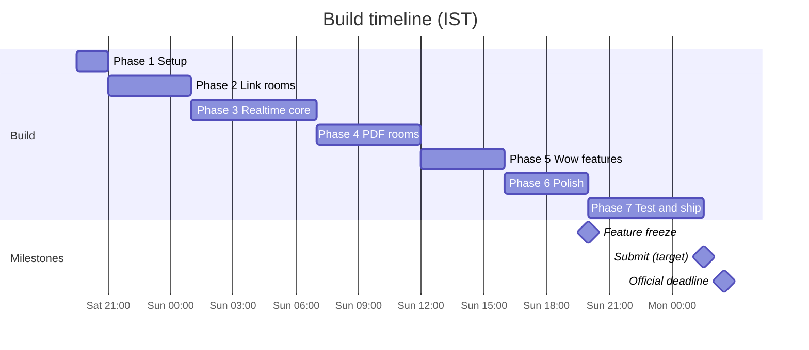

# LinkRoom: Hackathon Implementation Plan

Last updated: Oct 30, 2026

## Overview

LinkRoom turns any link or PDF into a live multiplayer room in one click. Paste a URL or drop a PDF, share the room link, and everyone reads, highlights, comments and gets an AI group recap together.

**Pitch line:** "The internet is single-player. LinkRoom makes every link multiplayer."

**Theme fit (Multiplayer Everything):** it works on almost any link or PDF, it is only useful with other people, and judges can join a live room from a single URL with no install or login.

| Milestone | US Central | India (IST) |
| --- | --- | --- |
| Applications close | Fri Oct 30, 11:59 PM | Sat Oct 31, 10:29 AM |
| Kickoff: theme, rules, judging | Sat Oct 31, 9:00 AM | Sat Oct 31, 7:30 PM |
| Submissions close | Sun Nov 1, 3:00 PM | Mon Nov 2, 2:30 AM |
| Winners announced | Sun Nov 1, 6:00 PM | Mon Nov 2, 5:30 AM |

The build window is 31 hours, for teams of 2 to 4. These dates come from the event screenshots; confirm the submission rules at kickoff.

## Prioritized feature list

Ship every P0 before starting any P1, and start P2 only if all P0 and P1 work is stable by Sunday 4 PM IST. P3 items are listed on purpose: they look tempting but cost more than they return in 31 hours.

| Priority | Feature | What it does | Why it matters | Effort (est. hours) |
| --- | --- | --- | --- | --- |
| P0 | Link to room | Paste a URL; the server extracts the article in reader mode and creates a room | The core promise: any link becomes multiplayer | 4 |
| P0 | PDF to room | Drop a PDF; it is stored and rendered page by page | Covers research papers, slides, notes | 4 |
| P0 | Join with name, no login | Enter a name, get a random colour, you are in | Judges join in 10 seconds | 1 |
| P0 | Shareable room link | Short URL plus a Copy button | Lets people invite each other | 0.5 |
| P0 | Presence bar | Avatars of everyone online | First visible proof of multiplayer | 1 |
| P0 | Live cursors | Named, coloured cursors that glide smoothly | The instant wow moment | 3 |
| P0 | Shared highlights | Select text, highlight it, everyone sees it live | The main collaboration action | 4 |
| P0 | Comment threads | Discuss any highlight in a side panel | Turns reading into a discussion | 3 |
| P0 | Error fallback | Clear message plus a Paste text instead option when a site cannot be read | Some sites block fetching; the demo must never dead-end | 1 |
| P1 | Follow mode | Click an avatar to follow their scroll; Bring everyone here button | Feels like a guided tour; very demo-able | 3 |
| P1 | AI group recap | Claude summarises what the group highlighted and debated; appears on every screen at once | Strong AI moment that is still multiplayer | 3 |
| P1 | Emoji reactions | Floating reactions on a paragraph | Fun, lively, cheap to build | 2 |
| P1 | QR code join | QR code in the room header | Judges join from their phones during the demo | 0.5 |
| P1 | Live demo rooms on landing page | Join a live room now button with pre-made rooms | Judges try it without creating anything | 2 |
| P1 | Activity feed | Who highlighted or commented on what, newest first | Makes a busy room easy to follow | 2 |
| P1 | Mobile-friendly room | Usable layout on a phone | Judges may open it on a phone | 2 |
| P2 | Attention heatmap | Margin bar showing which paragraphs the group read and highlighted most | Unique, visual, and easy to explain | 3 |
| P2 | Ask AI about a paragraph | Ask Claude a question; the answer is visible to the whole room | Shared AI instead of private chat | 3 |
| P2 | Agree or disagree votes | Vote on any highlight or comment | Shows where the group splits | 2 |
| P2 | Export notes | Download highlights, comments and recap as Markdown | Gives the room a useful output | 1 |
| P2 | Synced YouTube | Paste a YouTube link; playback and timestamp comments stay in sync | Extends "any link" to video | 4 |
| P2 | One-line script SDK | A script tag that adds cursors and comments to any website | Shows the engine is a platform | 4 |
| P2 | Session replay | Replay how the room's highlights and comments unfolded | Nice for async teammates | 4 |
| P3 | Accounts and login | Email or OAuth sign-in | Adds friction and no demo value; skip | 3 |
| P3 | Multi-paragraph highlights | Highlights that span several blocks | Offset maths gets fragile; limit highlights to one block | 4 |
| P3 | Voice chat | Talk inside the room | WebRTC is a time sink; Discord already exists | 6 |
| P3 | Original site via proxy or iframe | Show the real site instead of reader mode | Many sites block iframes and proxies break layouts | 6 |
| P3 | Co-editing the document | Change the text together | A different product (needs CRDTs); out of scope | 8 |
| P3 | Browser extension | Multiplayer on any tab | Judges will not install it; store review takes days | 6 |
| P3 | Private rooms and permissions | Passwords and roles | Not needed for a demo; mention as future work | 3 |

## Ideas that make it impressive

Judges reward what they can feel in the first 30 seconds, so these ideas target the demo moment, polish and the story rather than more features.

1. **Put the judges inside the product.** Show a QR code and a live room link during the demo, and ask a judge to paste any link of their own. "Give us any link" proves the claim live.
2. **Build one killer 30-second moment.** Three windows side by side: cursors glide, one person highlights, the highlight appears everywhere, then the AI recap lands on all screens at once.
3. **Make the AI multiplayer, not private.** Recaps and Ask AI answers are shared objects that everyone sees and can comment on. That ties the AI directly to the theme.
4. **Show data only a group can create.** The attention heatmap (which paragraphs the group read and highlighted most) is impossible for a single-player tool.
5. **Sweat the micro-polish.**
   - Smooth cursor interpolation, and idle cursors fade after 5 seconds.
   - Each person keeps one colour across cursor, avatar and highlights.
   - "abhishek joined" toasts, skeleton loaders, good empty states, dark mode.
6. **Make it fast.** A room should be ready in under 3 seconds. Pre-create demo rooms so the demo never waits on a slow site.
7. **Tell a real story.** Open the video with a concrete group, for example a study group reading an arXiv paper the night before an exam, then show the same flow for team docs and news.
8. **Hint at a platform.** A tiny one-line script SDK demo, or even a "coming next" slide, shows the engine can make any website multiplayer.
9. **Prove reliability.** Keep a "tested links" gallery (Wikipedia, MDN, Paul Graham essays, arXiv PDFs, popular blogs) on the landing page or in the README.
10. **Ship a judge-friendly repo.** A README with a GIF, the architecture diagram, a feature list, setup steps and known limits. Judges often skim the repo before scoring.
11. **Opt into sponsor job outreach** when submitting, since sponsors meet the people who opted in on results night.

## Tech stack and architecture

One Next.js app on Vercel plus one Supabase project covers everything, so there is no separate backend server to run.

| Layer | Choice | Why |
| --- | --- | --- |
| Framework | Next.js (App Router) + TypeScript | Pages and API routes in one codebase |
| UI | Tailwind CSS, shadcn/ui, framer-motion | Fast, polished components and smooth cursor animation |
| Database, realtime, files | Supabase (Postgres, Realtime, Storage) | Presence, broadcast and live row changes in one free-tier service |
| Link extraction | `@mozilla/readability` + `jsdom` (or `linkedom`) | Turns a messy web page into clean article HTML |
| Sanitizing | `isomorphic-dompurify` | Blocks scripts from extracted pages |
| PDF rendering | `react-pdf` (pdf.js) with the text layer | Selectable text for highlights |
| AI | `@anthropic-ai/sdk` + `zod`, model `claude-opus-5-5` | Structured JSON recaps |
| Room IDs and QR | `nanoid`, `qrcode.react` | Short links and phone joining |
| Hosting | Vercel | Deploys on every push |

```bash
npm i @supabase/supabase-js @mozilla/readability jsdom isomorphic-dompurify react-pdf @anthropic-ai/sdk zod nanoid framer-motion qrcode.react
```



Cursors, scroll and reactions travel browser to browser over the realtime channel and are never stored. Highlights, comments, rooms and recaps are saved in Postgres, and each new row reaches every browser through realtime changes.

## Step-by-step implementation

The build runs in seven phases. Each phase ends in a working, deployed state, so the project can be submitted from any phase if time runs out.

### Phase 0: Before kickoff (no app code)

- [ ] Apply before Sat Oct 31, 10:29 AM IST and join the trmi Discord
- [ ] Create accounts: GitHub, Vercel, Supabase, Anthropic Console (API key plus a spending limit)
- [ ] Owner installs the Claude GitHub App on the repo if Claude should push code
- [ ] Sketch wireframes: landing page, room, comment panel, recap panel
- [ ] Pick 5 demo links and 2 demo PDFs
- [ ] Decide the name, logo and colour palette

### Phase 1: Setup (Sat 7:30 to 9 PM IST)

- [ ] `create-next-app` with TypeScript, Tailwind and the App Router in the repo; run `shadcn init`
- [ ] Create the Supabase project, run the schema SQL, add the tables to the realtime publication, and create a `pdfs` storage bucket
- [ ] Add env vars locally and in Vercel: `NEXT_PUBLIC_SUPABASE_URL`, `NEXT_PUBLIC_SUPABASE_ANON_KEY`, `SUPABASE_SERVICE_ROLE_KEY`, `ANTHROPIC_API_KEY`
- [ ] Connect the repo to Vercel and deploy
- [ ] Agree on a workflow: short-lived feature branches, small PRs, merge to `main` often

Done when: the live Vercel URL loads.

### Phase 2: Link rooms (Sat 9 PM to Sun 1 AM)

- [ ] `POST /api/rooms/link`: validate the URL, block private hosts, fetch with a 10 s timeout, run Readability, sanitize with DOMPurify, add block IDs, insert the room
- [ ] Landing page input posts the link and redirects to `/r/[id]`
- [ ] Room page loads the room on the server; `ArticleView` renders it with reader typography
- [ ] `JoinDialog`: name plus a random colour, saved in localStorage
- [ ] Error state with a Paste text instead fallback

Done when: pasting a Wikipedia link opens a clean, readable room.

### Phase 3: Realtime core (Sun 1 to 7 AM)

- [ ] `useRoomChannel` hook with presence, broadcast and Postgres changes
- [ ] `PresenceBar` with avatars
- [ ] Live cursors: block anchors, 50 ms throttle, smooth animation, idle fade
- [ ] Highlights: selection, floating toolbar, insert, live render for everyone
- [ ] `CommentPanel` with threads per highlight

Done when: two browsers see each other's cursors, highlights and comments live.

### Phase 4: PDF rooms (Sun 7 AM to 12 PM)

- [ ] Upload to Supabase Storage with a 20 MB limit; `POST /api/rooms/pdf` creates the room
- [ ] `PdfView` with react-pdf, text layer on, `data-block="p{n}"` on each page, lazy rendering
- [ ] Reuse the cursor and highlight code unchanged

Done when: a PDF room has the same live features as a link room.

### Phase 5: Wow features (Sun 12 to 4 PM)

- [ ] Follow mode plus Bring everyone here
- [ ] AI group recap route and `RecapPanel`, delivered to every screen through realtime
- [ ] Emoji reactions
- [ ] QR code in the room header

Done when: the full demo flow works end to end.

### Phase 6: Polish (Sun 4 to 8 PM)

- [ ] Landing page with live demo rooms
- [ ] Toasts, skeleton loaders, empty states, dark mode, mobile layout, activity feed
- [ ] P2 features only if everything above is stable

Done when: feature freeze at 8 PM IST. After that, only bug fixes.

### Phase 7: Test and ship (Sun 8 PM to Mon 1:30 AM)

- [ ] Bug bash on 3 devices, including one phone
- [ ] Record the demo video and write the README
- [ ] Fill in Devpost and submit by 1:30 AM IST, one hour before the deadline

## Database schema

Four tables hold everything that must persist. Cursors, scroll positions and reactions never touch the database; they travel over realtime broadcast only. Run this in the Supabase SQL editor:

```sql
create table rooms (
  id text primary key,                 -- nanoid(8)
  kind text not null check (kind in ('link','pdf')),
  source_url text,
  title text,
  content_html text,                   -- link rooms: sanitized HTML with data-block IDs
  pdf_path text,                       -- pdf rooms: Supabase Storage path
  created_at timestamptz default now()
);

create table highlights (
  id uuid primary key default gen_random_uuid(),
  room_id text references rooms(id) on delete cascade,
  author_name text not null,
  author_color text not null,
  block_id text not null,              -- link: "b12" | pdf: "p3"
  start_offset int not null,
  end_offset int not null,
  quote text not null,
  created_at timestamptz default now()
);

create table comments (
  id uuid primary key default gen_random_uuid(),
  room_id text references rooms(id) on delete cascade,
  highlight_id uuid references highlights(id) on delete cascade,
  author_name text not null,
  author_color text not null,
  body text not null,
  created_at timestamptz default now()
);

create table recaps (
  id uuid primary key default gen_random_uuid(),
  room_id text references rooms(id) on delete cascade,
  data jsonb not null,
  created_at timestamptz default now()
);

alter publication supabase_realtime add table highlights, comments, recaps;
```

- **No accounts.** Name and colour live in localStorage; presence carries them.
- **One anchor model for both kinds.** Every paragraph in a link room is a block (`b0`, `b1`, …) and every PDF page is a block (`p1`, `p2`, …), so cursors and highlights share one code path.
- **Row-level security.** For the hackathon, allow anonymous select and insert on these tables and say so in the README. Only the server uses the service role key, to create rooms and recaps.

## Key implementation details

Six pieces carry the hard engineering: extraction, the realtime channel, cursor anchoring, highlight offsets, follow mode and the AI recap. Everything else is UI.

### 1. Link extraction (`app/api/rooms/link/route.ts`)

```ts
import { JSDOM } from "jsdom";
import { Readability } from "@mozilla/readability";
import DOMPurify from "isomorphic-dompurify";
import { nanoid } from "nanoid";

export const runtime = "nodejs";

export async function POST(req: Request) {
  const { url } = await req.json();
  const u = new URL(url);
  if (!["http:", "https:"].includes(u.protocol) || isPrivateHost(u.hostname))
    return Response.json({ error: "Invalid URL" }, { status: 400 });

  const res = await fetch(u, {
    headers: { "User-Agent": "Mozilla/5.0 (LinkRoom reader)" },
    signal: AbortSignal.timeout(10_000),
  });
  const dom = new JSDOM(await res.text(), { url: u.href });
  const article = new Readability(dom.window.document).parse();
  if (!article?.content)
    return Response.json({ error: "We couldn't read this page. Try pasting the text instead." }, { status: 422 });

  const html = addBlockIds(DOMPurify.sanitize(article.content));
  const id = nanoid(8);
  await supabaseAdmin.from("rooms").insert({
    id, kind: "link", source_url: u.href, title: article.title, content_html: html,
  });
  return Response.json({ id });
}

function addBlockIds(html: string) {
  const { document } = new JSDOM(`<body>${html}</body>`).window;
  let i = 0;
  document.querySelectorAll("p, h1, h2, h3, h4, h5, h6, li, blockquote, pre, figure")
    .forEach((el) => el.setAttribute("data-block", `b${i++}`));
  return document.body.innerHTML;
}
```

- `isPrivateHost` rejects `localhost`, `127.*`, `10.*`, `172.16-31.*`, `192.168.*` and `169.254.*` to prevent server-side request forgery.
- DOMPurify is mandatory: without it, a hostile page could run scripts inside your room.
- If `jsdom` makes the Vercel function too large, swap it for `linkedom`.

### 2. Realtime channel (`lib/useRoomChannel.ts`)

```ts
const channel = supabase.channel(`room:${roomId}`, {
  config: { presence: { key: myId }, broadcast: { self: false } },
});

channel
  .on("presence", { event: "sync" }, () => setPeople(channel.presenceState()))
  .on("broadcast", { event: "cursor" }, ({ payload }) => moveCursor(payload))
  .on("broadcast", { event: "scroll" }, ({ payload }) => maybeFollow(payload))
  .on("broadcast", { event: "react" }, ({ payload }) => spawnReaction(payload))
  .on("postgres_changes",
      { event: "INSERT", schema: "public", table: "highlights", filter: `room_id=eq.${roomId}` },
      ({ new: h }) => addHighlight(h))
  .on("postgres_changes",
      { event: "INSERT", schema: "public", table: "comments", filter: `room_id=eq.${roomId}` },
      ({ new: c }) => addComment(c))
  .subscribe(async (status) => {
    if (status === "SUBSCRIBED") await channel.track({ name, color, following: null });
  });
```

Throttle outgoing events: cursors every 50 ms, scroll position every 200 ms.

### 3. Cursor anchoring (`lib/anchors.ts`)

Pixel coordinates break across different screen widths, so each cursor is sent relative to the block under it:

```ts
export function toAnchor(e: PointerEvent) {
  const el = (e.target as HTMLElement).closest<HTMLElement>("[data-block]");
  if (!el) return null;
  const r = el.getBoundingClientRect();
  return { block: el.dataset.block!, x: (e.clientX - r.left) / r.width, y: (e.clientY - r.top) / r.height };
}

export function fromAnchor(a: { block: string; x: number; y: number }, container: HTMLElement) {
  const el = container.querySelector<HTMLElement>(`[data-block="${a.block}"]`);
  if (!el) return null;
  const r = el.getBoundingClientRect(), c = container.getBoundingClientRect();
  return { left: r.left - c.left + a.x * r.width, top: r.top - c.top + a.y * r.height };
}
```

Animate cursor movement with framer-motion so it glides instead of jumping.

### 4. Highlight offsets (`lib/highlights.ts`)

```ts
export function selectionToHighlight(sel: Selection) {
  if (sel.isCollapsed) return null;
  const range = sel.getRangeAt(0);
  const node = range.commonAncestorContainer;
  const el = node instanceof Element ? node : node.parentElement;
  const block = el?.closest<HTMLElement>("[data-block]");
  if (!block) return null; // selection spans several blocks: not supported in the MVP
  const before = document.createRange();
  before.selectNodeContents(block);
  before.setEnd(range.startContainer, range.startOffset);
  const start = before.toString().length;
  const quote = range.toString();
  return { block_id: block.dataset.block!, start_offset: start, end_offset: start + quote.length, quote };
}
```

To render, walk the block's text nodes, find the ones covering `start_offset` to `end_offset`, and wrap those slices in `<mark data-highlight-id>` styled with the author's colour. Wrapping does not change the block's `textContent`, so stored offsets stay valid.

### 5. Follow mode

Each person broadcasts the block at the top of their viewport as `{ block, ratio }`. Followers call `el.scrollIntoView({ behavior: "smooth" })` on that block. Bring everyone here sends a `summon` event that every client obeys, and a banner shows "Following abhishek · Stop".

### 6. AI group recap (`app/api/rooms/[id]/recap/route.ts`)

```ts
import Anthropic from "@anthropic-ai/sdk";
import { z } from "zod";
import { zodOutputFormat } from "@anthropic-ai/sdk/helpers/zod";

export const runtime = "nodejs";
const client = new Anthropic(); // reads ANTHROPIC_API_KEY

const Recap = z.object({
  one_line_summary: z.string(),
  key_points: z.array(z.string()),
  what_the_group_cared_about: z.array(z.object({ quote: z.string(), who: z.array(z.string()), why: z.string() })),
  disagreements: z.array(z.string()),
  open_questions: z.array(z.string()),
  next_steps: z.array(z.string()),
});

export async function POST(_: Request, { params }: { params: Promise<{ id: string }> }) {
  const { id } = await params;
  const { title, text, highlights, comments } = await loadRoomData(id);

  const response = await client.messages.parse({
    model: "claude-opus-5-5",
    max_tokens: 16000,
    output_config: { effort: "low", format: zodOutputFormat(Recap) },
    system: "You summarize a group's shared reading session. Focus on what the people highlighted and discussed, not just the document.",
    messages: [{
      role: "user",
      content: `Document: ${title}\n\n${text.slice(0, 60_000)}\n\nHighlights:\n${JSON.stringify(highlights)}\n\nComments:\n${JSON.stringify(comments)}`,
    }],
  });

  if (response.stop_reason === "refusal" || !response.parsed_output)
    return Response.json({ error: "Recap failed" }, { status: 502 });

  await supabaseAdmin.from("recaps").insert({ room_id: id, data: response.parsed_output });
  return Response.json(response.parsed_output);
}
```

The insert into `recaps` reaches every client through Postgres changes, so the recap appears on all screens at once. Very long documents are cut at 60,000 characters; list that as a known limit.

## Timeline and team roles

The 31 hours split into seven phases, with a feature freeze at 8 PM IST Sunday and submission one hour before the official deadline.



Sleep in shifts so someone is always awake, and have the whole team online from Sunday 4 PM IST until submission.

| Member | Owns | Main phases |
| --- | --- | --- |
| A: Realtime and frontend | `useRoomChannel`, presence bar, live cursors, follow mode, reactions | 3, 5 |
| B: Backend | Supabase schema and storage, link extraction, PDF upload, env vars and deploys | 1, 2, 4 |
| C: Content and AI | `ArticleView`, `PdfView`, highlights, comment threads, AI recap | 2 to 5 |
| D: Product and demo | Landing page, design, demo rooms, testing, video, README, Devpost | 6, 7 |

With 3 people, split D's work across the team. With 2 people, one takes A and C, the other takes B and D, and the only P1 feature is the AI recap.

## Demo and submission

The demo video should run about 2 minutes 30 seconds and show three people in one room within the first minute.

| Time | Scene | What viewers see |
| --- | --- | --- |
| 0:00–0:20 | The problem | "We share links, then discuss them through screenshots in chat. The internet is single-player." |
| 0:20–0:50 | Create and join | Paste a Wikipedia link, copy the room link, three windows side by side join |
| 0:50–1:30 | Read together | Cursors glide, one person highlights, another comments, reactions float, follow mode jumps everyone to a paragraph |
| 1:30–1:55 | Any PDF | Drop an arXiv PDF; the same live features work |
| 1:55–2:20 | AI recap | Click Recap; the group summary lands on every screen at once |
| 2:20–2:30 | Close | "Any link. Any PDF. Instantly multiplayer." plus the live URL and QR code |

### Submission checklist

- [ ] Live deployed URL with 2 or 3 pre-made demo rooms
- [ ] Public GitHub repo with a README: GIF, architecture diagram, features, setup steps, known limits
- [ ] Demo video uploaded (YouTube or Vimeo, public or unlisted)
- [ ] Devpost story: Inspiration, What it does, How we built it, Challenges, Accomplishments, What we learned, What's next
- [ ] Screenshots of the landing page, a busy room and the recap
- [ ] Built-with tags: Next.js, Supabase, Claude, Vercel, Tailwind
- [ ] Every teammate added to the Devpost project
- [ ] Opt into sponsor job outreach if offered
- [ ] Submitted by 1:30 AM IST Monday, one hour before the deadline

The exact Devpost fields have not been verified yet; confirm them at kickoff.

## Risks and fallbacks

The biggest risk is a site that cannot be read during a live demo, so demo only with pre-tested links and keep a recorded video as backup. The pre-kickoff checklist is Phase 0 above.

| Risk | Fallback |
| --- | --- |
| A site blocks fetching or renders only with JavaScript (X, paywalled news) | Clear error plus Paste text instead; demo with tested links only |
| `jsdom` makes the Vercel function too large | Switch to `linkedom` |
| Cursors land in the wrong place on different screens | Block anchors already solve this; test on a phone and a wide monitor |
| Highlight offsets drift | Keep highlights within one block and verify against the stored `quote` |
| Too many realtime messages | Throttle cursors to 50 ms and scroll to 200 ms; never store them |
| Large PDFs load slowly | 20 MB upload limit, render pages lazily |
| Hostile HTML from extracted pages | DOMPurify on every extraction |
| Server-side request forgery through the URL box | Allow only http and https, block private and local hosts |
| AI recap is slow or fails | Show a loading state, retry once, then show a friendly error; the room keeps working |
| API costs run away | Spending limit in the Anthropic Console; recap button disabled for 30 s after use |
| Wi-Fi or an API fails during judging | Pre-recorded demo video and pre-made demo rooms |
| The team runs out of time | Every phase ends deployed; freeze features at 8 PM IST Sunday |
